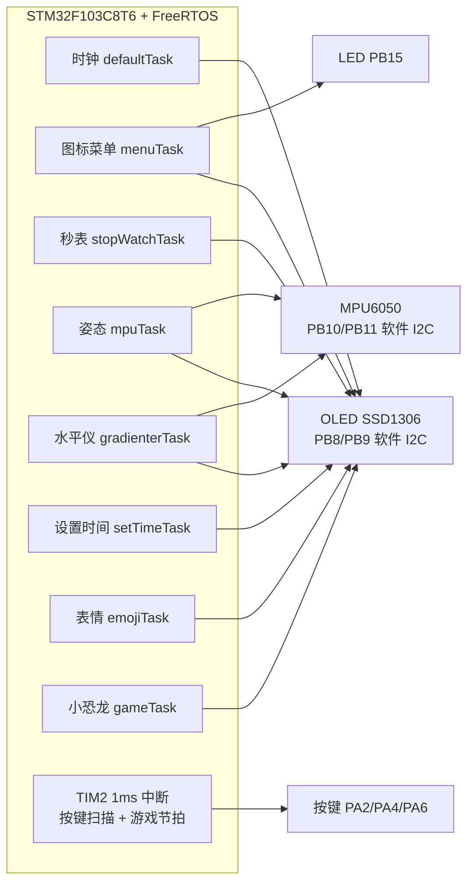

# 基于 STM32 HAL 库和 FreeRTOS 的智能手表

这是一个在 **STM32F103C8T6** 上从零搭建的多功能手表项目：RTC 时钟、图标菜单、体育秒表、手电筒、MPU6050 姿态页与水平仪、表情动画、小恐龙游戏、时间设置。整体使用 **STM32CubeMX + HAL 库 + FreeRTOS（CMSIS-RTOS2）**，在 Keil MDK 下编译，0.96 寸 SSD1306 OLED 显示。

仓库保留了 CubeMX 生成的工程结构和 ST 官方 HAL/FreeRTOS 源码，clone 后可以直接打开 Keil 工程编译；**手写和移植的核心代码**集中在 `Watch/Hardware/`、`Watch/Core/Src/freertos.c`、`Watch/Core/Src/main.c` 等文件里，README 下方有逐项说明。

项目报告（PDF）：[基于STM32 HAL库和FreeRTOS的手表项目.pdf](基于STM32%20HAL库和FreeRTOS的手表项目.pdf)

---

## 功能一览

| 功能 | 说明 |
|---|---|
| 主时钟 | 顶部日期 `20YY-MM-DD`，中间 12×24 大字号 `HH:MM:SS`，每秒刷新 |
| 图标菜单 | 8 个 32×32 图标横向轮播，44×48 选中框固定，切换带滑动动画 |
| 秒表 | 体育秒表格式 `MM:SS.CC`，开始/暂停/复位，离开页面后台继续计时 |
| 手电筒 | PB15 LED 开关，离开页面保持状态 |
| MPU6050 姿态 | 显示 Roll / Pitch，20Hz 刷新 |
| 水平仪 | 外圆内小球随倾斜方向滚动，限制在圆内 |
| 表情 | 笑脸每约 2 秒眨一次眼 |
| 小恐龙 | 地面滚动、跳跃、仙人掌、计分、AABB 碰撞、GAME OVER |
| 设置时间 | 年/月/日/时/分/秒逐项调整，保存到 RTC，复位后保持 |

## 硬件与引脚

| 模块 | 型号 / 连接 |
|---|---|
| 主控 | STM32F103C8T6 最小系统板，72MHz，64KB Flash，20KB RAM |
| 显示 | 0.96 寸 SSD1306 OLED，SCL=PB8，SDA=PB9（软件 I2C） |
| 姿态 | GY-521 / MPU6050（实际为 MPU-6500），SCL=PB10，SDA=PB11，AD0=GND |
| 按键 | Key1=PA6（上一项）、Key2=PA4（下一项）、Key3=PA2（确认，长按回主页） |
| 指示灯 | PB15，低电平点亮 |
| 调试 | USART1，PA9/PA10，115200 8N1 |
| 电池检测 | PA0 ADC（CubeMX 已配置，界面暂未使用） |

时钟：HSE 8MHz × 9 = 72MHz，APB1 36MHz，ADC ÷6；HAL 时基 TIM4，FreeRTOS SysTick 1ms。RTC 因板子没有 32.768kHz 晶振，使用 HSE/128 = 62.5kHz。

## 软件架构

界面类功能按“页面”拆成任务，同一时刻只让一个任务操作 OLED，所以显存不需要额外互斥锁；页面切换用 `osThreadResume()` / `osThreadSuspend()` 完成。按键扫描和游戏节拍放在 TIM2 的 1ms 中断里。

| 任务 | 栈 | 职责 |
|---|---|---|
| defaultTask | 512 B | 时钟界面，读 RTC、刷新日期时间 |
| menuTask | 512 B | 图标轮播、选中确认、手电筒内层页面 |
| stopWatchTask | 512 B | 秒表计时与刷新（后台继续计时） |
| mpuTask | 1024 B | MPU6050 姿态页 Roll / Pitch |
| gradienterTask | 1024 B | 水平仪小球 |
| setTimeTask | 512 B | 时间字段编辑并写回 RTC |
| emojiTask | 1024 B | 表情眨眼动画 |
| gameTask | 1024 B | 小恐龙游戏渲染与碰撞 |

FreeRTOS 堆 `configTOTAL_HEAP_SIZE` 为 12288 字节，节拍 1000Hz。

## 目录结构

| 路径 | 说明 |
|---|---|
| `Watch/Core/` | CubeMX 生成的外设初始化与启动代码；`Src/freertos.c`、`Src/main.c` 含大量用户代码 |
| `Watch/Hardware/` | **手写/移植的驱动与数据**：OLED、MyI2C、MPU6050、Key、Dino、MenuIcon |
| `Watch/Drivers/` | ST 官方 HAL 驱动（第三方） |
| `Watch/Middlewares/` | FreeRTOS 内核与 CMSIS-RTOS2（第三方） |
| `Watch/MDK-ARM/` | Keil 工程，打开 `Watch.uvprojx` |
| `Watch/Watch.ioc` | STM32CubeMX 工程配置 |
| `基于STM32 HAL库和FreeRTOS的手表项目.pdf` | 项目报告，含原理、实现与调试记录 |

> Keil 的编译产物（`Watch/MDK-ARM/Watch/`）、`*.uvoptx`、`*.uvguix.*`、`build_log.txt`、`.mxproject` 等已通过 `.gitignore` 排除。

## 编译方法

1. 用 **Keil MDK 5**（ARM Compiler 5.06）打开 `Watch/MDK-ARM/Watch.uvprojx`。
2. 确认 C/C++ 预定义包含：`USE_HAL_DRIVER, STM32F103xB, CMSIS_device_header="stm32f1xx.h"`。
3. 确认 Misc Controls 包含 `--no-multibyte-chars`（否则 UTF-8 中文字模会报 `#8: missing closing quote`）。
4. 编译并下载到 STM32F103C8T6。
5. 如需重新生成工程：用 STM32CubeMX 6.11.x 打开 `Watch/Watch.ioc`，FreeRTOS 接口选 CMSIS_V2，堆大小设为 12288，HAL 时基选 TIM4。

## 手写/移植的主要工作

- **OLED 驱动 HAL 移植**：把江协科技 V2.0 的 4 针 I2C OLED 标准库移植到 HAL，改写 GPIO 层（`HAL_GPIO_WritePin` + 开漏初始化），补充 12×24 字模和 `OLED_ShowImageOR()`（不清背景的叠加画法，解决恐龙脚下地面被擦掉的问题）。
- **两条软件 I2C**：OLED 用 PB8/PB9，MPU6050 用 PB10/PB11；`MyI2C.c` 实现起始、停止、收发字节、应答/非应答。
- **MPU6050 驱动**：寄存器初始化（200Hz 采样、±16g、±2000°/s、DLPF）、三轴数据读取、`atan2f` 计算 Roll/Pitch；水平仪角度到像素的映射与圆形限位。
- **按键扫描**：TIM2 1ms 中断 + 20ms 采样 + 松手锁存 + 长按 1 秒判断，避免轮询漏键和抖动。
- **FreeRTOS 任务框架**：时钟、菜单、秒表、姿态、水平仪、设置时间、表情、游戏八个任务的创建、挂起/唤醒与页面切换。
- **体育秒表**：基于 `osKernelGetTickCount()` 的 1ms 节拍计时，暂停结算、后台继续；只刷新时间行的 `OLED_UpdateArea()` 降低 I2C 负载。
- **图标菜单**：32×32 图标轮播、44×48 选中框、每步 8 像素滑动动画、循环取模；第 8 个“设置时间”图标为自绘。
- **小恐龙游戏**：把参考工程的精灵、地面纹理、跳跃曲线、计分与 AABB 碰撞整合进 FreeRTOS 任务，并把游戏节拍挂到 TIM2 1ms 中断。
- **RTC 掉电/复位处理**：无 LSE 时使用 HSE/128；利用 `RTC_BKP_DR1` 写入 0x32F2 标记，让复位后保留时间、跳过 CubeMX 每次上电的默认时间设置。

## 调试过程中解决的代表性问题

- Keil + CMSIS_V2 的编译链问题：`CMSIS_device_header` 未定义、`INCLUDE_xTaskGetCurrentTaskHandle` 未开启、`SysTick_Handler` 重复定义。
- UTF-8 中文字模在 AC5 下报 `missing closing quote`：加 `--no-multibyte-chars`。
- `strlen` / `sqrtf` 隐式声明：补 `<string.h>` / `<math.h>`，并改用 `sprintf` 返回值作为发送长度。
- 复制粘贴导致函数重复定义、任务属性漏写：统一按“句柄+属性/声明/创建/任务函数/菜单分支”检查。
- **`osThreadSuspend(NULL)` 在 CMSIS-RTOS2 封装里不生效**：改用 `osThreadSuspend(osThreadGetId())`，解决 MENU 一秒后被时钟覆盖、提示文字残留的问题。
- RTC 分频误会：`RTC_AUTO_1_SECOND` 是特殊标记，F1 HAL 会根据 HSE/128 自动算出 62499，不需要手改。
- MPU6050 读出 `0x70`：模块实际是 MPU-6500，寄存器与 MPU-6050 兼容，驱动无需修改。
- 小恐龙脚下地面缺一层：江协库的 `OLED_ShowImage()` 会先清空矩形，新增 `OLED_ShowImageOR()` 只做像素叠加。
- 复位后时间归零：`Check_RTC_BKUP` 里读 `RTC_BKP_DR1` 的 0x32F2 标记，提前 `return` 跳过默认时间设置。
- 任务增多导致堆不足：`configTOTAL_HEAP_SIZE` 从 3072 逐步加到 12288，按任务实际需要分配 512/1024 字节栈。
- 秒表百分秒刷新导致 I2C 压力大：从全屏 `OLED_Update()` 改为 `OLED_UpdateArea()` 只刷时间行。

## 第三方与参考

- `Watch/Drivers/`：STMicroelectronics STM32F1 HAL 驱动，遵循 ST 的许可协议。
- `Watch/Middlewares/`：FreeRTOS 内核与 CMSIS-RTOS2 封装，遵循 FreeRTOS MIT 许可。
- OLED 显示库与字模参考/移植自江协科技 V2.0 开源 OLED 库；小恐龙精灵与菜单动画思路参考了一个开源 STM32 手表工程。仓库中的整合、HAL 适配、FreeRTOS 任务框架、界面逻辑与调试过程为本项目的主要工作。

## 已知限制

- 板子没有 VBAT 纽扣电池：复位能保留时间，完全断电后 RTC 会归零。
- 电池 ADC 已配置但界面尚未显示电量。
- 菜单与提示文字以英文为主，中文字模只包含常用字符。
- 姿态角仅使用加速度计，未做陀螺仪互补滤波，快速晃动时会有抖动。
- RAM 余量较小（约 18.6KB / 20KB），后续增加功能需要先核算内存。
